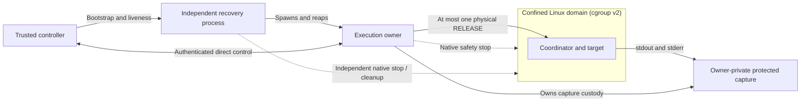
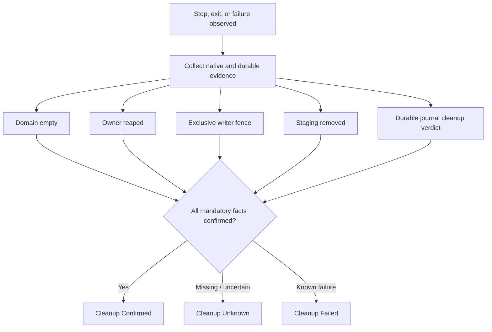

# Gagamba

**Standalone .NET process-lifecycle infrastructure and an experimental Linux restricted-execution sandbox.**

Gagamba offers two related but distinct capabilities:

- **Cross-platform process lifecycle management.** Published preview packages provide a common `IExecutionProvider` contract, requirement-based provider selection, and native process ownership and termination facilities for Windows, Linux, and macOS. These are **not** general-purpose security sandboxes.
- **Experimental Linux restricted execution.** A separate, locally qualified implementation combines confined execution, one-shot release authority, independent recovery, native safety stopping, and bounded protected output capture. Its security claims are limited to the environments and cases actually tested.

Gagamba is a standalone project. Using its lifecycle facilities does not require Penghou, Hufu, an agent framework, or a workflow engine.

> **Security status (October 31, 2026):** Linux restricted-execution milestones **B1–B4 are accepted with qualifications**, based on source-bound evidence and independent security review under **WSL2 Ubuntu**. **B5–B7 remain incomplete; production restricted execution is unavailable.** Do not treat the experimental implementation, its tests, or the existing lifecycle providers as authorization to execute arbitrary hostile code. See the [current project status](docs/PROJECT-STATUS.md).

## What works today

| Area | Demonstrated state | Important boundary |
| --- | --- | --- |
| Process lifecycle providers | Preview packages for Windows Job Objects, Linux cgroup v2, and macOS launchd; common lifecycle contract and conformance tests | These manage processes; they do **not** provide filesystem, network, identity, or IPC isolation |
| Restricted manifest and passive inspection | RC2A component and local package qualification accepted with qualifications | Parsing, references, and digests grant **no** execution or release authority |
| Linux restricted execution (B1–B4) | Integrated controller/recovery/owner topology, preparation and HELD state, authenticated one-shot release, independent native stop, bounded protected capture | Demonstrated in an **experimental WSL2 profile**, not a production deployment |
| Durable recovery and installed trust | B5 sealed deadlines and reconciliation, B6 installation/attestation, and B7 broader lifecycle qualification are still outstanding | The production restricted-execution provider remains unavailable |

The Linux native qualification includes genuine process-death and fault-injection cases. **A passing security-invariant test is not automatically a cleanup-success claim:** the accepted B4 cleanup interpretation is **20 Confirmed / 12 Unknown**. See the [B4 owner acceptance](docs/decisions/rc2b-04-b4-owner-acceptance.md) for the correction and its limits.

## Experimental Linux architecture

The controller, recovery process, and execution owner are deliberately separate. The **owner alone** holds the live preparation capability, journal writer, and physical RELEASE authority. Recovery retains native domain and staging handles so it can stop and clean up independently; it does **not** receive a release bearer.



The authenticated controller-to-owner connection is direct, not a release proxy through recovery. The qualified Linux implementation uses pidfds, protected Unix-domain communication, retained cgroup handles, and fail-closed behavior when required authority or evidence is missing. These results are specific to the accepted experimental setup.

### Why cleanup can remain Unknown

Stop acceptance, kernel-domain emptiness, owner reaping, writer fencing, staging removal, and durable journal completion are **different facts**. An empty domain alone does not prove completed cleanup.



In particular, **physically removing a retained directory does not turn a durable `Unknown` verdict into `Confirmed`**. The accepted B4 review identified and documented this reporting distinction; the qualification harness correction remains a follow-up.

## Published process-lifecycle packages

Gagamba's published preview package family covers the **process lifecycle API**, not the experimental restricted-execution provider:

| Package | Purpose |
| --- | --- |
| `Gagamba.Execution` | Shared `IExecutionProvider` contract, capabilities, and fail-closed negotiation |
| `Gagamba.Runtime` | `ExecutionRuntime` and requirement-driven OS provider selection |
| `Gagamba.Execution.Windows` | Windows Job Objects lifecycle provider |
| `Gagamba.Execution.Linux` | Linux cgroup v2 lifecycle provider |
| `Gagamba.Execution.MacOS` | macOS launchd lifecycle provider |

A lifecycle-only example:

```csharp
await using var runtime = ExecutionRuntime.Create();
var prep = runtime.Prepare(new ExecutionRequirements(new[]
{
    ExecutionRequirement.Require(ExecutionCapability.UnitTermination),
    ExecutionRequirement.Require(ExecutionCapability.SurvivesRootExit),
}));
// Inspect whether preparation was accepted before launching.
// This does not create a restricted sandbox.
```

The published preview line uses `0.1.0-preview.*` versions; consult NuGet and the [provider conformance documentation](docs/conformance.md) for package-specific information. Publishing uses [the repository workflow](.github/workflows/publish.yml).

### Passive restricted contracts

The accepted RC2A work provides immutable manifest views, strict canonical encoding/decoding, SHA-256 verification, and passive preparation references. RC2A-04 qualified a **local package candidate** with qualifications. That does **not** establish that a published preview includes these APIs or that a valid manifest/reference can start a sandbox.

See the [frozen restricted API contract](docs/design/restricted-consumer-contract-rc2a-01-api.md) and [RC2A-04 owner acceptance](docs/decisions/rc2a-04-owner-acceptance.md).

## Security boundaries and remaining work

The established Linux restricted-execution evidence is limited to the declared unprivileged WSL2 environment. It does **not** establish:

- Production readiness or an available public restricted-execution provider. `RestrictedExecutionRuntime.Create()` still refuses production restricted execution.
- Native Linux-host or macOS sandbox qualification, a restricted Windows backend, or cross-platform equivalence.
- Protection against malicious same-UID host processes, privileged administrators, or a compromised trusted bootstrap.
- Completed B5 sealed-C3 deadlines and durable reconciliation, B6 installed-artifact attestation, or B7 comprehensive lifecycle and fault qualification.
- Global closure of **R1-F02** or resolution of every cleanup uncertainty.
- Hufu integration, microVM/HCS support, or automatic policy/authorization decisions.

The process lifecycle providers have a different, narrower contract: they do not promise filesystem grants, network denial, credential isolation, IPC restrictions, or restrictions on other services available to the host account. The [offline-process-v1 security model](docs/security-model.md) describes research goals, **not** features already enforced by those providers.

## Build, verify, and explore

The repository contains the runtime and providers (`src/`), tests and native fixtures (`tests/`), experimental runners (`eng/`), and source-bound evidence (`docs/evidence/`).

For the existing read-only preparation verification on Windows:

```powershell
powershell.exe -NoProfile -ExecutionPolicy Bypass -File .\eng\verify-preparation.ps1
```

This validates preparation/documentation state; **it does not prove sandbox isolation or run a restricted workload**. See [testing and CI](docs/testing-and-ci.md) and [test environments](docs/test-environments.md) for broader qualification context.

The native restricted-execution matrices require the separately controlled WSL2 environment, a delegated unprivileged cgroup v2 user unit, protected artifact pins, and exact qualification profiles. They are internal security qualification tools, **not** a safe one-command public sandbox launcher.

## Documentation

- [Current project status](docs/PROJECT-STATUS.md) and [work queue](docs/work-queue.md): authoritative current checkpoint and next gates
- [Engineering handoff](docs/handoff.md): current implementation and evidence trail
- [Restricted consumer / execution contract](docs/design/restricted-consumer-contract-rc1.md): authority, process, and result semantics
- [INT-01 owner acceptance](docs/decisions/rc2b-03-int-01-owner-acceptance.md): integrated topology and qualified limitations
- [B4 owner acceptance](docs/decisions/rc2b-04-b4-owner-acceptance.md): protected capture, stopping, cleanup erratum, remaining findings
- [B4 independent security review](docs/reviews/rc2b-04-b4-q1-independent-security-review.md): adversarial assessment and exact evidence limits
- [B4 producer evidence](docs/evidence/rc2b-04-b4-impl-01.md): native cases, regressions, manifests, and environment
- [Original design and research](docs/design.md) and [feasibility review](docs/feasibility-review.md): historical exploration, not the current implementation status

**Current direction:** correct the bounded cleanup-qualification reporting issue before relying on later aggregate cleanup statistics, then separately commission B5. No later milestone is automatically authorized by the acceptance of B4.
