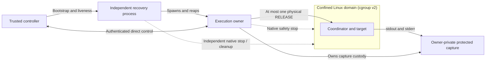
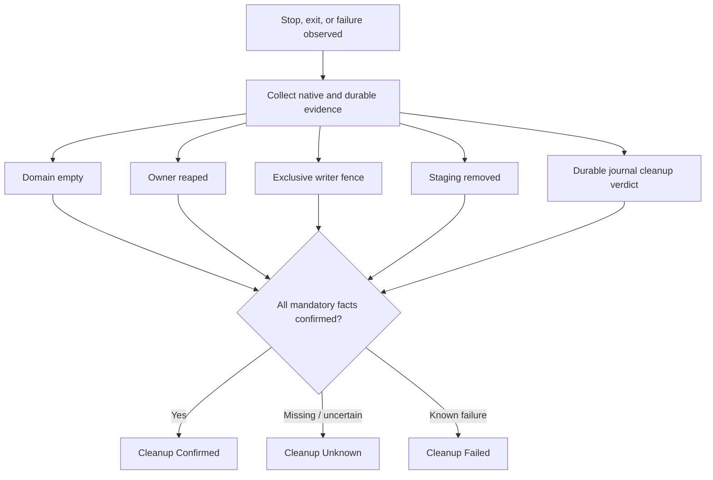

# Gagamba

**Standalone .NET process-lifecycle infrastructure and an experimental Linux restricted-execution sandbox.**

Gagamba offers two related but distinct capabilities:

- **Cross-platform process lifecycle management.** Published preview packages provide a common `IExecutionProvider` contract, requirement-based provider selection, and native process ownership and termination facilities for Windows, Linux, and macOS. These are **not** general-purpose security sandboxes.
- **Experimental Linux restricted execution.** A separate, locally qualified implementation combines confined execution, one-shot release authority, independent recovery, native safety stopping, and bounded protected output capture. Its security claims are limited to the environments and cases actually tested.

Gagamba is a standalone project. Using its lifecycle facilities does not require Penghou, Hufu, an agent framework, or a workflow engine.

> **Security status (November 7, 2026):** the Linux restricted-execution work is **accepted with qualifications through the B1–B5 milestones**, and B6 installed-artifact trust is in progress (installation specification, S1 and S2 accepted with qualifications; S3 implementation awaiting independent review; the B6-F02 final-admission foundation accepted with native qualification deferred). The Alternative B **P1–P4 refusal-only coverage** and the **Slice E-1 prepublication integrity projection** are accepted with qualifications. **No positive validation bootstrap exists, protected native positive execution is not qualified, and production restricted execution remains unavailable.** Do not treat the experimental implementation, its tests, or the lifecycle providers as authorization to execute arbitrary hostile code. See the [current project status](docs/PROJECT-STATUS.md).

## What works today

| Area | Demonstrated state | Important boundary |
| --- | --- | --- |
| Process lifecycle providers | Preview packages for Windows Job Objects, Linux cgroup v2, and macOS launchd; shared lifecycle contract and conformance tests | These manage processes; they do **not** provide filesystem, network, identity, or IPC isolation |
| Restricted manifest and passive inspection | RC2A component and local package qualification accepted with qualifications | Parsing, references, and digests grant **no** execution or release authority |
| Linux restricted execution (B1–B5) | Integrated controller/recovery/owner topology, preparation and HELD state, authenticated one-shot release, independent native stop, bounded protected capture, and sealed C3 deadlines/reconciliation | Demonstrated in an **experimental WSL2 profile**, not a production deployment |
| B6 installed-artifact trust | Installation-identity specification and trust store accepted with qualifications; S1/S2 accepted; S3 in review; B6-F02 final-admission separation owner-accepted | Protected-store provisioning and native loaded-closure qualification remain pending |
| Alternative B authority slices (P1–P4, E-1) | Owner-side manifest admission, owner pre-RELEASE generation verification, controller Q10, the 29-boundary P4 refusal-only coverage, and an internal prepublication integrity projection — all accepted **with qualifications** | Refusal-only: no positive validation, no constructible validation authority, no production consumer |

The Linux native qualification includes genuine process-death and fault-injection cases. **A passing security-invariant test is not automatically a cleanup-success claim:** the accepted B4 cleanup interpretation is **20 Confirmed / 12 Unknown**. See the [B4 owner acceptance](docs/decisions/rc2b-04-b4-owner-acceptance.md) for the correction and its limits.

## Experimental Linux architecture

The controller, recovery process, and execution owner are deliberately separate. The **owner alone** holds the live preparation capability, journal writer, and physical RELEASE authority. Recovery retains native domain and staging handles so it can stop and clean up independently; it does **not** receive a release bearer.



The authenticated controller-to-owner connection is direct, not a release proxy through recovery. The qualified Linux implementation uses pidfds, protected Unix-domain communication, retained cgroup handles, and fail-closed behavior when required authority or evidence is missing. These results are specific to the accepted experimental setup.

### Why cleanup can remain Unknown

Stop acceptance, kernel-domain emptiness, owner reaping, writer fencing, staging removal, and durable journal completion are **different facts**. An empty domain alone does not prove completed cleanup.



In particular, **physically removing a retained directory does not turn a durable `Unknown` verdict into `Confirmed`**. The accepted B4 review identified and documented this reporting distinction.

## Platform support

| Platform | Process lifecycle provider (published preview) | Restricted-execution sandbox |
| --- | --- | --- |
| Windows | Job Objects: unit termination, descendant ownership, owner-death cleanup | **None.** There is no Windows restricted backend. Windows is used to build the projects and run portable/deterministic tests; that is **not** protected native Windows sandbox qualification |
| Linux | cgroup v2 (requires an operator-delegated cgroup subtree; otherwise `Prepare` fails closed) | Experimental **Linux M1 profile only** (WSL2 x86-64), unprivileged, with delegated cgroup v2. Not a production backend |
| macOS | launchd | **None** |
| BSD / other | **None** (not implemented; not planned in-repo) | **None** |

On Windows, Job Objects provide **no** filesystem, registry, network, identity, or IPC isolation — only process ownership and termination. The Linux and macOS lifecycle providers have the same narrow lifecycle contract. The [offline-process-v1 security model](docs/security-model.md) describes research goals, **not** features already enforced by these providers.

## Published process-lifecycle packages

Gagamba's published preview package family covers the **process lifecycle API**, not the experimental restricted-execution provider. All five packages are published on NuGet at `0.1.0-preview.*` (`preview.1`–`preview.4`):

| Package | Purpose |
| --- | --- |
| `Gagamba.Execution` | Shared `IExecutionProvider` contract, capabilities, and fail-closed negotiation |
| `Gagamba.Runtime` | `ExecutionRuntime` and requirement-driven OS provider selection |
| `Gagamba.Execution.Windows` | Windows Job Objects lifecycle provider |
| `Gagamba.Execution.Linux` | Linux cgroup v2 lifecycle provider |
| `Gagamba.Execution.MacOS` | macOS launchd lifecycle provider |

A lifecycle-only example:

```csharp
await using var runtime = ExecutionRuntime.Create();
var prep = runtime.Prepare(new ExecutionRequirements(new[]
{
    ExecutionRequirement.Require(ExecutionCapability.UnitTermination),
    ExecutionRequirement.Require(ExecutionCapability.SurvivesRootExit),
}));
// Inspect whether preparation was accepted before launching.
// This does not create a restricted sandbox.
```

Consult NuGet and the [provider conformance documentation](docs/conformance.md) for package-specific information. Publishing uses [the repository workflow](.github/workflows/publish.yml) and is gated on a successful qualification run of the exact source commit.

### Passive restricted contracts

The accepted RC2A work provides immutable manifest views, strict canonical encoding/decoding, SHA-256 verification, and passive preparation references. RC2A-04 qualified a **local package candidate** with qualifications. That does **not** establish that a published preview includes these APIs or that a valid manifest/reference can start a sandbox.

See the [frozen restricted API contract](docs/design/restricted-consumer-contract-rc2a-01-api.md) and [RC2A-04 owner acceptance](docs/decisions/rc2a-04-owner-acceptance.md).

## Current development status

The restricted-execution work is organized as bounded, separately authorized milestones. As of November 7, 2026:

- **Accepted with qualifications:** B1–B5; the B6-specification and wire contracts; B6-S1, B6-S2, and the B6-F02 "Mechanism B" final-admission foundation; the B6-S3 B2 wire delta; controller Q10; and the Alternative B P1–P4 authority slices plus the Slice E-1 prepublication integrity projection.
- **Implemented, awaiting independent review / native qualification:** B6-S3 (trusted installation-identity propagation); the B6-F02 native positive/negative matrix remains `NATIVE-PENDING`.
- **Not implemented / not authorized:** the B7 lifecycle slice; full Q04/S09 pre-effect sink coverage; the atomic positive-validation bootstrap (Slice E, packages E-2 through E-7); protected installed-positive native qualification (Slice N); and production activation.

Outstanding qualifications the project tracks explicitly:

- **F-01 (mandatory before production integration):** the E-1 prepublication projection's internal `FromEvidence` does not yet cross-check its owner/recovery closure and runtime inventory against authoritative values. It is non-blocking today because the projection is production-unreachable, but it must be closed before any production consumer, semantic reliance, or trusted-boundary expansion.
- **F-02:** the E-1 verifier duplicates part of the existing verified-installed path; parity must be re-analyzed whenever either path changes, and consolidation versus explicit parity coverage decided before production integration.
- **F-03:** `eng/test-production-build.ps1` has a Windows PowerShell 5.1 log-encoding defect that fails its own negative-control match even though the underlying verifier behaves correctly; a bounded tooling fix and rerun are required before citing the full script as passing.
- **Frozen-schema and approval prerequisites:** the detailed validation contract (catalog/fixture/policy/action schemas, the GAVA1 header, the v3 pre-publication parser, release correlation) is accepted only through external packages and prior-decision hashes, and the validation-catalog approval chain has no in-repo owner decision yet. Both must be reconciled before the schema-dependent Slice E packages.
- **Native qualification:** 331 native test cases are unqualified skips and are **not** passes; protected positive execution remains pending.

See the [current project status](docs/PROJECT-STATUS.md) for the authoritative checkpoint.

## Security boundaries and remaining work

The established Linux restricted-execution evidence is limited to the declared unprivileged WSL2 environment. It does **not** establish:

- Production readiness or an available public restricted-execution provider. `RestrictedExecutionRuntime.Create()` still returns an unavailable provider, and no positive validation path exists.
- Native Linux-host or macOS sandbox qualification, a restricted Windows backend, or cross-platform equivalence.
- Protection against malicious same-UID host processes, privileged administrators, or a compromised trusted bootstrap.
- Completed protected native positive execution, positive validation bootstrap, B7 lifecycle/fault qualification, or resolution of every cleanup uncertainty.
- Global closure of **R1-F02**, or global closure of the P4 F-R1/O-R1, O-R2, and O-R3 qualifications.
- Hufu integration, microVM/HCS support, or automatic policy/authorization decisions.

The P4 work is a **refusal-only** boundary: within its 29 reconciled boundaries it demonstrates no production authority or RELEASE bypass, but this is not equivalent to protected native positive qualification or production activation. Preparatory acceptances are **not** incremental activation authorization, and positive validation remains non-constructible until the complete accepted atomic-enablement boundary exists.

The process lifecycle providers have a different, narrower contract: they do not promise filesystem grants, network denial, credential isolation, IPC restrictions, or restrictions on other services available to the host account. The [offline-process-v1 security model](docs/security-model.md) describes research goals, **not** features already enforced by those providers.

## Build, test, and explore

The repository contains the runtime and providers (`src/`), tests and native fixtures (`tests/`), experimental runners and qualification tooling (`eng/`), and source-bound evidence (`docs/evidence/`).

Build and run the portable tests on Windows:

```powershell
dotnet build src/Gagamba.Execution.Linux.M1/Gagamba.Execution.Linux.M1.csproj -c Debug
dotnet test tests/Gagamba.Execution.Linux.M1.Tests/Gagamba.Execution.Linux.M1.Tests.csproj -c Debug
```

For the existing read-only preparation verification on Windows:

```powershell
powershell.exe -NoProfile -ExecutionPolicy Bypass -File .\eng\verify-preparation.ps1
```

This validates preparation/documentation state; **it does not prove sandbox isolation or run a restricted workload**. See [testing and CI](docs/testing-and-ci.md) and [test environments](docs/test-environments.md) for broader qualification context.

The native restricted-execution matrices require the separately controlled WSL2 environment, a delegated unprivileged cgroup v2 user unit, protected artifact pins, and exact qualification profiles. They are internal security qualification tools, **not** a safe one-command public sandbox launcher.

## Documentation

- [Current project status](docs/PROJECT-STATUS.md) and [work queue](docs/work-queue.md): authoritative current checkpoint and next gates
- [Engineering handoff](docs/handoff.md): current implementation and evidence trail
- [Restricted consumer / execution contract](docs/design/restricted-consumer-contract-rc1.md): authority, process, and result semantics
- [Alternative B owner decision](docs/decisions/rc2b-06-b6-integrated-start-authority-owner-decision-01.md) and [atomic implementation plan](docs/plans/rc2b-06-b6-integrated-start-authority-impl-01.md): owner-side authority and the Slice E dependency set
- [P4 refusal-only coverage acceptance](docs/decisions/rc2b-06-b6-alt-b-p4-coverage-owner-acceptance-01.md) and [29-row sink reconciliation](docs/evidence/rc2b-06-b6-alt-b-p4-coverage-recon-01.md)
- [Slice E-1 owner acceptance](docs/decisions/rc2b-06-b6-alt-b-slice-e-01-owner-acceptance-01.md) and [independent Q1 qualification](docs/reviews/rc2b-06-b6-alt-b-slice-e-01-q1.md)
- [B4 owner acceptance](docs/decisions/rc2b-04-b4-owner-acceptance.md): protected capture, stopping, cleanup erratum, remaining findings
- [B4 independent security review](docs/reviews/rc2b-04-b4-q1-independent-security-review.md): adversarial assessment and exact evidence limits
- [B4 producer evidence](docs/evidence/rc2b-04-b4-impl-01.md): native cases, regressions, manifests, and environment
- [Original design and research](docs/design.md) and [feasibility review](docs/feasibility-review.md): historical exploration, not the current implementation status

**Current direction:** close the bounded F-01 cross-check prerequisite before any production consumer; correct the F-03 tooling defect; reconcile the frozen-schema and validation-catalog approval prerequisites before the schema-dependent Slice E packages; and keep protected native qualification (Slice N) separate. No later milestone is automatically authorized by the acceptance of E-1.
