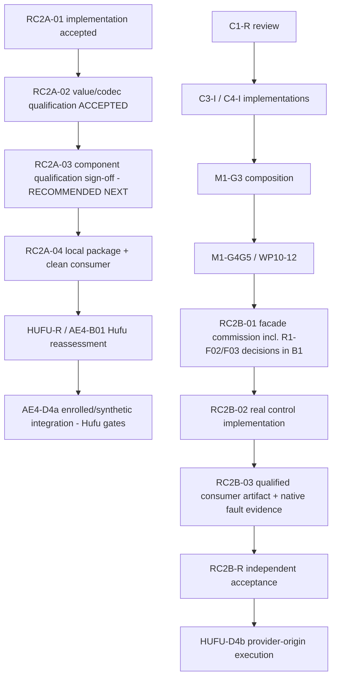

# RC2A-ROADMAP-01 — restricted execution roadmap and dependency review

Assessment ID: RC2A-ROADMAP-01. Date: 2026-10-26 (Asia/Manila).
Type: read-only architectural and dependency assessment; **not implementation authorization.**

## 1. Assignment purpose and constraints

Following the formal RC2A-02 full-stage acceptance, this assessment reconstructs
the accepted capability boundary, reviews the remaining restricted-execution
milestones (RC2A-03, RC-2B R1-F02/F03, RC2A-04, AE4-B01, and other
roadmap-tracked items), and recommends the **smallest bounded next engineering
assignment** that materially advances Gagamba toward a demonstrably safe,
authorized restricted-execution path without prematurely expanding scope.

Constraints honored: no production, test, native, evidence, or decision
modification; no execution probes; no merge/push/publication; no
implementation of any candidate. The assessment may be committed as
documentation only.

## 2. Exact Git baseline

| Item | Identity |
|---|---|
| Assessment branch | `assessment/gagamba-rc2a-roadmap-01` |
| Assessment worktree | `C:\Users\Laszlos\source\repos\Solo\rc2a-roadmap-assess` |
| Baseline commit (RC2A-02 full-stage acceptance) | `9519e7cb612af6ff69c93c0d128553138533d9fd` |
| Baseline tree | `7b162d2b0e00d72c27a2389ed505d531758797f1` |
| Parent | `a36cb684ad75cebf3ba778a6c86d42d7f5f2d6f6` |
| Accepted disposition | [RC2A-02 full-stage owner acceptance](../decisions/restricted-consumer-contract-rc2a-02-full-stage-owner-acceptance.md): ACCEPTED WITH QUALIFICATIONS |
| Supporting assessment | RC2A-02-FSA-01 at `058a150130c5f112c7e9b8189bba8842cf0cec52` (tree `b2211a26c838f98f994602e5c56ea8bb95b2c1d8`, report blob `5b4f559d71e8bb6b871a28f73be694b742887bdd`), verdict READY FOR OWNER ACCEPTANCE — read from its committed Git object; not merged |
| Assessment commit | recorded in the completion report (self-reference avoided) |

Production `src` `b8c167e3d7340a562221591bdc2b6df7adb372d1`, `native`
`85631d2f04512376621d3d09f51d67fd90f45335`, frozen API blob
`2d6b9d12cab02f092c6b6e0b690138cf6726f12b` — unchanged at this baseline.

## 3. Authoritative source inventory

| Source | Role |
|---|---|
| [RC2A-02 full-stage owner acceptance](../decisions/restricted-consumer-contract-rc2a-02-full-stage-owner-acceptance.md) | Accepted stage boundary, carried qualifications, exclusions |
| [RC2A-02 qualification plan](../plans/restricted-consumer-contract-rc2a-02-qualification.md) | Stage contract; §1 defines RC2A-03 as "component qualification sign-off" and RC2A-04 as "packaging and clean-consumer qualification", both outside RC2A-02 |
| [Implementation work orders](../plans/restricted-consumer-contract-implementation.md) | Progress/gates table (§1) — authoritative RC2A-03/RC2A-04 deliverable rows; §3 RC-2B facade definition and B1–B7 work packages; §6 Hufu resumption decision (AE4-B01 prerequisites) |
| [RC-1 design](../design/restricted-consumer-contract-rc1.md) | RC-1A/RC-2A vs RC-1B/RC-2B separation; component capability inventory; AE4-B01 design question and the D4a/D4b artifact requirements |
| [Q2A-S / RC-D04 owner disposition](../decisions/gagamba-q2as-rcd04-owner-disposition.md) | RC-2B live-operation half of RC-D04; RC2A-03 sequencing note |
| [work-queue](../../docs/work-queue.md) / [handoff](../../docs/handoff.md) | Current status and decision index |
| RC2A-02A/02B/02C evidence packages and reviews | Accepted qualification evidence (identities in the full-stage acceptance §2) |

No separate RC2A-03 or RC2A-04 plan document exists; their authoritative
definitions are the implementation plan §1 deliverable rows plus the RC2A-02
plan's stage-boundary statements. This assessment does not invent absent plans.

## 4. Current accepted capability baseline

| Layer | Implemented | Locally tested | Independently qualified | Owner-accepted | Boundary |
|---|---|---|---|---|---|
| Consumer contract: passive value + codec (`RestrictedPreparationReference`, views, `RestrictedManifestCodec`, strict decode/refusal vocabulary) | Yes (RC2A-01, `src` `b8c167e3…`) | Yes (57 public + 38 internal + qualification suites) | Yes (RC2A-02A/B/C + Q1/Q1/Q2/Q2 reviews) | Yes (RC2A-02 full stage ACCEPTED WITH QUALIFICATIONS) | Passive only: parsing confers no provenance, establishment, or authority |
| Contract identity/compatibility | Frozen API blob `2d6b9d12…`; golden bytes preserved | Yes | Yes | Yes | — |
| Authority enforcement (issuance, scope, delegation, revocation, fail-closed) | Internal capability objects exist (`PreparedTransaction`/`PreparationStore`); public consumer surface exposes none | Internal only | No | No | Live authority path is RC-2B (`PreparedRestrictedExecution`, B1–B7) — NOT IMPLEMENTED for consumers |
| Execution confinement (native isolation, containment, resources, termination, cleanup) | Exists inside native WP05/M1 workstreams with producer evidence (C1 producer-only; C2 WSL2 component evidence preserved) | Partially (native suites) | C2 component evidence independently reviewed; production offline/network/inode/runtime/core gaps OPEN | Not accepted for consumer restricted execution | No consumer-reachable confinement guarantee; no dependency from RC-2A onto G3/G4/G5 |
| Lifecycle: preparation → acceptance → execution → completion → release → retained state → recovery | Internal/native partial | Partial | No | No | RC-2B B1–B7; R1-F02/F03 design decisions OPEN (deferred to RC-2B) |
| Hufu integration (AE4-B01/D4a; D4b) | Hufu unchanged at `37dcf333…`; design exists | No | No | No | AE4-B01 OPEN; blocked on accepted RC2A package + Hufu's own gates |
| Packaging/distribution (RC-T12/T17) | Not started | No | No | No | RC2A-04; publication is a separate decision |

The accepted passive/live boundary is explicit in the accepted contracts: the
RC-2A value/codec layer can inspect evidence on Windows without claiming
Windows can execute the profile; RC-2B's distinct restricted control facade
retains live authority internally and does not exist as a public consumer
surface today. Authority *issuance* belongs to Hufu (D4a enrolled/synthetic
evidence; D4b provider-origin execution); Gagamba's consumer contract
correctly exposes no authority minting or consumption.

**Tracking-hygiene observation (non-blocking):** the implementation plan §1
progress-table row for RC2A-02 still carries its pre-full-stage status text
("…FULL RC2A-02 NOT ACCEPTED"), while the authoritative current-status
section of the same document, the work queue, the handoff, and the accepted
decision all record the full-stage acceptance. The row is a historical
checkpoint per the table's own conventions; the accepted decision is
authoritative. Recommended disposition: refresh the row in the next
documentation-only tracking update (not in this read-only assessment).

## 5. Remaining security and execution-boundary gaps

Ranked by significance to the restricted-execution objective:

1. **No qualified component boundary for the consumer artifact.** The
   implementation is source-qualified (RC2A-02) but the *component* — the
   `Gagamba.Execution` restricted consumer surface as a deliverable — has no
   qualification sign-off (RC2A-03 row: "stage not started; qualification
   pending"). Everything downstream (package, Hufu D4a evidence, release
   framing) currently cites implementation-stage evidence.
2. **No package/clean-consumer qualification.** Hufu's AE4-B01 reassessment
   explicitly requires "actual package bytes/hash, dependency graph, canonical
   vectors and strict validation/immutability evidence from the clean
   consumer" (implementation plan §6); RC2A-04 is NOT_STARTED.
3. **R1-F02/F03 unresolved stop/correlation semantics** for the future RC-2B
   facade (pre-mint queued-stop latch; pre-retention correlation mismatch
   retention/consumption). Security-significant for RC-2B, but they are
   specification obligations assigned to RC2B-01's B1 package, not to any
   currently authorized stage.
4. **No live restricted-execution facade** (RC-2B B1–B7) and no accepted
   native C1/C3/C4 component implementations (C1-R, C3-I, C4-I pending;
   M1-G3/G4G5 pending) — the actual confinement/lifecycle/recovery
   enforcement points.
5. **Hufu integration boundary** (AE4-B01 → D4a → D4b) — blocked per §6 of
   the implementation plan until the accepted RC2A package exists.

## 6. Candidate milestone comparison

### Candidate A: RC2A-03 — component qualification sign-off

- **Authoritative purpose** (implementation plan §1): deliverable "Shared
  validation/reader, public views and passive reference"; status "SOURCE
  IMPLEMENTED UNDER RC2A-01; stage not started; qualification pending;
  **Q2A-S / RC-D04 RC2A-02C evidence is a pre-acceptance gate**".
- **Gate status:** the pre-acceptance gate is now satisfied — RC2A-02C was
  qualified, independently reviewed (13/13), and owner-accepted, and the
  full stage is accepted.
- **Required work:** bind the component source identity to the accepted
  RC2A-02-tested identities (no-drift verification against `src`
  `b8c167e3…`/`native` `85631d2f…`/frozen API blob `2d6b9d12…`); record the
  component-level qualification (public surface, codec semantics, views,
  passive reference) citing the accepted RC2A-02 evidence; record the
  component boundary and exclusions; owner sign-off. No new implementation is
  indicated by any authoritative record; new test execution is not required
  where accepted evidence already establishes the behavior.
- **Security guarantees intended:** a durable, reviewable statement that the
  component consumed downstream exposes exactly the accepted passive surface
  with the qualified refusal/canonicality behavior — the boundary every later
  consumer (package, Hufu) inherits.
- **Independently executable as a bounded assignment:** yes. Evidence
  readiness is high; scope is small; regression risk is minimal (no code
  change contemplated).
- **Prerequisites:** none outstanding (the 02C gate is closed).

### Candidate B: RC-2B R1-F02/F03

- **Exact obligations:** (R1-F02) specify and test the observable pre-mint
  queued-stop latch so a pending stop can never yield a releasable capability
  (RC-T18); (R1-F03) decide whether pre-retention correlation mismatch is
  retained/consuming and whether a later matching call may proceed (RC-T23).
- **Why open:** RC1-A deliberately deferred both to RC-2B; the implementation
  plan records the reviewer's questions "without silently choosing its
  recommendation or implementing either behavior in RC-2A."
- **Severity/security significance:** high for the future facade — both
  concern authority lifecycle safety (stop-then-release; replay/mismatch).
- **Do they affect the current boundary?** No. The consumer contract exposes
  no mint/release path; RC2A-02 was accepted with these explicitly excluded.
- **Do they block RC2A-03/04/AE4-B01?** No authoritative record makes them a
  prerequisite for RC-2A stages; they belong to RC2B-01's B1 package, which
  itself requires accepted C1–C4 implementations and a separate commission.
- **Resolution type:** contract/clarification + future implementation and
  qualification inside RC2B-01. **Not the next assignment** — acting now
  would contradict the authoritative sequencing (the decisions are owned by
  the RC2B-01 commission).

### Candidate C: RC2A-04 — focused regressions, local package, clean consumer

- **Planned scope** (implementation plan §1 row; RC-T12/T17): focused
  regression rerun, local package build, clean exact-version NuGet consumer
  exercising public API only with an isolated cache; package review (the
  RC2A-R "package review pending" item).
- **Dependencies:** naturally follows RC2A-03 (component sign-off) — packaging
  an unsigned-off component would be premature; the HUFU-R blocker requires
  the "accepted RC2A source/package".
- **Security risks of premature packaging:** distributing a surface whose
  component boundary is not yet signed off invites consumption ahead of the
  qualified contract; the plan itself gates publication as a separate
  decision.
- **Preparatory value:** real but larger; it needs RC2A-03's boundary record
  to describe what is being packaged.

### Candidate D: AE4-B01

- **Intended contract** (implementation plan §6): Hufu (Sol) reassesses
  AE4-B01 and requests D4a authorization, consuming accepted RC-1/RC-2A
  source/API/version, resolved review findings, actual package bytes/hash and
  dependency graph, canonical vectors and strict validation/immutability
  evidence **from the clean consumer**, the accepted Mode/profile mapping, and
  the explicit absence of live-provider/native qualification. D4a uses
  enrolled/synthetic timing (no native provider calls); D4b requires accepted
  RC-2B plus C1–C4 and separate authorization.
- **Established vs unproven:** the RC-2A contract side is now accepted; the
  package evidence side (RC2A-04) and Hufu's own design/owner gates are not.
- **Trust-boundary crossings:** Hufu would consume the Gagamba package as an
  external consumer — exactly the clean-consumer scenario RC2A-04 qualifies.
- **Prerequisite status:** blocked on RC2A-04 (and Hufu's internal gates);
  **not actionable now**.

### Additional candidates

- **R1-F06 / HUFU-R recheck:** a reassessment trigger, blocked on the
  package; folds into AE4-B01 timing.
- **C1-R / C3-I / C4-I / M1-G3 / M1-G4G5 / RC2B-01..03 / HUFU-D4B:** native
  and facade commissions, each requiring separate authorization; none is
  actionable within the consumer-contract line, and none blocks RC2A-03/04
  (the plan states there is no dependency from RC-2A onto native G3/G4/G5).
- **Documentation hygiene:** the stale §1 tracking row (§4 above) — fold into
  the next disposition.

## 7. Dependency graph

Textual dependency table:

| Dependency | Type | Source / justification |
|---|---|---|
| RC2A-02 → RC2A-03 | qualification prerequisite | RC2A-02 plan §1 names RC2A-03 the component sign-off; q2as disposition §5 requires the passive-reference residual resolved before sign-off (satisfied by RC2A-02C) |
| RC2A-03 → RC2A-04 | sequencing (strong recommendation, not a hard gate in the records) | implementation plan §1 rows; packaging an unsigned-off component would defeat the sign-off's purpose |
| RC2A-04 → HUFU-R/AE4-B01 | hard contract prerequisite | implementation plan §6 (clean-consumer package evidence) and §1 HUFU-R row ("Accepted RC2A source/package…") |
| AE4-B01 → AE4-D4a | Hufu-internal authorization | implementation plan §6 ("not an automatic resume") |
| Accepted C1–C4 + M1 gates → RC2B-01..03 → RC2B-R | hard prerequisite chain | implementation plan §1 table + §3 entry ("cannot be replaced by WP05 fake prerequisites") |
| R1-F02/F03 → inside RC2B-01 (B1) | assignment-scoped obligation | implementation plan §3 ("B1/B3 must specify…", "B1 must explicitly decide…") |
| RC2B-R + Hufu authorization → HUFU-D4b | hard prerequisite | implementation plan §1 table; RC-1 design line 9 |
| RC-2A → native G3/G4/G5 | **none** (explicitly) | implementation plan §1 ("There is no dependency from RC-2A onto native G3/G4/G5") |

No dependency cycle exists; the two chains (consumer-contract line and
native/facade line) join only at HUFU-D4b. No contradictory roadmap
assumptions were found.

## 8. Security-property assessment

| Property | Classification | Basis / enforcement point |
|---|---|---|
| Authority — no execution without established authority | **PARTIALLY ESTABLISHED** | For the consumer surface: the accepted inventory proves no mint/consume/control member exists (RC2A-02C surface inventory; frozen API). For live execution: the authority path (RC-2B facade, provider-origin preparation) does not exist as a public surface; issuance belongs to Hufu (RC-1 §2; implementation plan §6). Enforcement point today: absence of API (passive-by-construction); future: RC-2B checked admission |
| Scope enforcement | **PARTIALLY ESTABLISHED** | Manifest-scope refusals (forced values, pending-only tags, closed error vocabulary) are qualified (RC2A-02A). *Resource/execution* scope enforcement during real execution is native/RC-2B and NOT ESTABLISHED (plan §6 exclusions). Enforcement point: codec validation (qualified); future runtime: native providers |
| Isolation | **NOT ESTABLISHED** (by design, at this layer) | RC-2A is a passive portable value layer; confinement belongs to M1/RC-2B (C2 WSL2 component evidence preserved; production offline gaps open). No consumer-reachable containment guarantee exists or is claimed |
| Determinism of security-relevant decisions | **ESTABLISHED BY ACCEPTED EVIDENCE** (value/codec layer) | Deterministic vectors/recipes, exact code/offset refusals, canonical rigidity, reproduced runs across platforms (RC2A-02A/B evidence; Q1/Q2 reproductions) |
| Lifecycle (cancel/fail/restart leaves no uncontrolled execution) | **NOT ESTABLISHED** | RC-2B B3/B4/B5; R1-F02 stop semantics OPEN. No consumer lifecycle surface exists |
| Recovery — stale/replayed authority | **NOT ESTABLISHED** | RC-2B B5 (no release on reconnect, no record-only adoption); R1-F03 OPEN |
| Evidence — guarantees independently demonstrable | **ESTABLISHED BY ACCEPTED EVIDENCE** (RC2A-02 scope) | Hash-bound packages, preserved unmerged reviews, reproduced builds/tests, recomputed manifests (02A 29/29, 02B 43/43, 02C 40/40) |
| Compatibility with accepted contracts | **ESTABLISHED BY ACCEPTED EVIDENCE** | Frozen API blob constant; golden bytes and `ReferenceEncoder` preserved; tests tree additions-only (full-stage assessment §7) |

Caveats honored: absence of demonstrated bypass is not proof of isolation; the
passing qualification suites do not prove end-to-end authorization. The only
qualified enforcement point today is the managed codec/surface validation.

## 9. Prioritization rationale

| Dimension | RC2A-03 | RC-2B R1-F02/F03 | RC2A-04 | AE4-B01 |
|---|---|---|---|---|
| Security impact | Establishes the qualified component boundary everything downstream consumes | High, but for a facade that cannot yet be built | Converts the boundary into a distributable, consumable artifact | External trust-boundary validation of that artifact |
| Dependency criticality | Unblocks RC2A-04 and supports HUFU-R | Unblocks RC2B-01 B1 design (already gated on C1–C4) | Unblocks HUFU-R/AE4-B01 | Unblocks D4a |
| Scope size | Small (sign-off + no-drift verification) | Small in isolation but owned by a larger, blocked commission | Medium (package + consumer + review) | External to Gagamba; blocked |
| Evidence readiness | High — RC2A-02 accepted evidence covers the component's public behavior | Design questions only | Low (NOT_STARTED) | N/A |
| Regression risk | Minimal (no code change) | None now | Low–medium (packaging) | N/A |
| Architectural value | Durable component gate | Durable facade semantics | Durable distribution contract | Integration boundary |
| Release relevance | Prerequisite for package | Long-lead | Direct | Long-lead |

RC2A-03 ranks first on every actionable dimension: it is the only candidate
whose prerequisites are fully satisfied today, it closes a genuine dependency
(component sign-off → package → Hufu), it requires no simultaneous subsystem
change, and it can be accepted or rejected as a bounded unit.

## 10. Recommended next bounded assignment

**Primary recommendation — assignment ID `RC2A-03-CQ1` (RC2A-03 component
qualification, slice 1): component qualification record and sign-off.**

- **Objective:** produce and owner-accept the RC2A-03 component qualification
  record for the restricted consumer component of `Gagamba.Execution`
  (shared validation/reader, public views, passive reference, codec) — the
  "component qualification sign-off" the stage contract reserves from
  RC2A-02.
- **Security guarantee advanced:** a durable, reviewable statement that the
  component exposed to any future consumer (package, Hufu) is exactly the
  accepted passive surface with the qualified canonical/refusal behavior —
  closing roadmap gap §5.1 without touching code.
- **Authoritative prerequisite status:** satisfied — the RC2A-02C
  pre-acceptance gate named in the implementation plan §1 RC2A-03 row is now
  closed by the RC2A-02 full-stage acceptance.
- **In scope:** a qualification branch from `9519e7c…` (or a later accepted
  tip); no-drift verification binding `src`/`native`/API-blob identities to
  the accepted evidence; a component qualification record citing the accepted
  RC2A-02A/B/C evidence with exact commit/tree identities; the component
  boundary and exclusion statement; tracking updates (including the stale §1
  RC2A-02 row); independent review of the record; owner sign-off decision.
- **Explicitly excluded:** any source/test/native change; RC2A-04 packaging;
  RC-2B design work (including R1-F02/F03 decisions); Hufu changes; native
  probes; publication.
- **Required work:** documentation + verification only. New test execution is
  **not** required where accepted evidence already establishes the behavior;
  if the no-drift verification fails, stop and record the discrepancy
  instead.
- **Minimum acceptance tests:** the record must demonstrate (a) identity
  equality between the component source and the qualified evidence, and (b)
  traceability from each component capability (codec, views, reference,
  refusal vocabulary) to its accepted qualification artifact.
- **Independent review:** a focused review that the record's claims match the
  accepted evidence and that no claim exceeds RC2A-02's qualified scope.
- **Expected evidence:** the qualification record + review, both bound to
  exact commits; updated progress/tracking rows.
- **Stop condition:** any identity mismatch, any evidence gap discovered, or
  any attempt to broaden claims beyond the accepted passive boundary stops
  the assignment and reports instead.

**Do not implement the whole RC2A-03 "stage" as a large effort:** on the
current records, the component's qualification content already exists in
RC2A-02; the remaining defensible work is the bounded sign-off above. If the
no-drift verification or review surfaces a genuine gap, the gap — not a new
test campaign — defines the follow-up.

## 11. Provisional acceptance criteria (PROPOSED — not authorized)

- **Positive behavior:** the component qualification record binds the
  component identity (`src` `b8c167e3…`, `native` `85631d2f…`, API blob
  `2d6b9d12…`, tested trees from RC2A-02) to the accepted evidence chain and
  states the component's qualified capabilities with artifact citations.
- **Refusal / fail-closed behavior:** the record must refuse sign-off if any
  identity drifts, any cited evidence is missing or unbound, or any claimed
  capability lacks an accepted artifact; discrepancies are recorded as
  findings, never silently resolved.
- **Adversarial cases (as applicable):** claim-vs-evidence audit (no
  capability cited without an accepted artifact); scope audit (no authority,
  temporal, release, confinement, packaging, or Hufu claim); compatibility
  audit (frozen API and golden identities unchanged).
- **Compatibility:** RC2A-02's accepted exit criteria, qualifications
  (F03; native Linux/macOS not-run; R2A-F03; audit-trail note; F01 erratum),
  and evidence identities remain unchanged and are cited, not restated as new
  claims.
- **Evidence:** qualification record + independent review, hash-bound and
  committed on a dedicated branch; updated tracking rows; no new execution
  artifacts required.
- **Qualifications:** the component inherits RC2A-02's qualifications
  verbatim; the record adds no platform, confinement, package, or
  reproducibility claim.

## 12. Alternative recommendation

If the owner prefers to defer RC2A-03, the fallback is a **bounded
RC2A-04-preparation slice**: the local-package build + clean exact-version
consumer check (RC-T12) with captured provenance, explicitly *without*
publication and *without* the component sign-off — accepting the recorded
risk that the packaged surface's component boundary would then rest on
RC2A-02 stage evidence rather than a component-level record. This is
second-best: it does more work, earlier, with weaker framing. If instead the
owner wants RC-2B progress, the honest bounded step is a **contract-decision
record for R1-F02/F03** — but the authoritative plan assigns those decisions
to RC2B-01's B1 package, so recording them now would create a duplicate
authority; this is noted only to make the trade-off explicit, not
recommended.

## 13. Explicit exclusions and unresolved uncertainties

- This assessment does not authorize RC2A-03, RC2A-04, RC-2B, AE4-B01, D4a,
  D4b, packaging, publication, or any code change.
- RC2A-02 acceptance is preserved unchanged (§14 of the full-stage decision;
  eight exit criteria; all carried qualifications). This review reopens
  nothing and found no contradiction with the accepted dispositions.
- Unresolved uncertainties recorded honestly: (1) no separate RC2A-03/RC2A-04
  plan documents exist — their scope is defined by the §1 deliverable rows and
  the RC2A-02 plan's boundary statements, so the recommended slice's precise
  document set is an owner choice at commissioning; (2) native-line statuses
  (C1-R, C3-I, C4-I, M1-G3/G4G5) are tracked in their own workstreams and
  were taken from the §1 table without re-verification of those workstreams;
  (3) the stale §1 tracking row is a hygiene item, not a status conflict.
- No bypass, defect, or evidence gap was discovered in the accepted RC2A-02
  record during this review.

## 14. Owner decision required

No implementation may begin until the owner records a decision. The exact
next authorization requested:

> **Authorize `RC2A-03-CQ1` — the RC2A-03 component qualification record and
> sign-off (documentation + verification slice), per §10–§11 of this
> assessment, on a dedicated qualification branch based on
> `9519e7cb612af6ff69c93c0d128553138533d9fd` (or a later accepted tip), with
> focused independent review before owner sign-off.**

All other milestones (RC2A-04, RC-2B/R1-F02/F03, AE4-B01, D4a/D4b, packaging,
publication) remain unauthorized and sequenced per §7.
