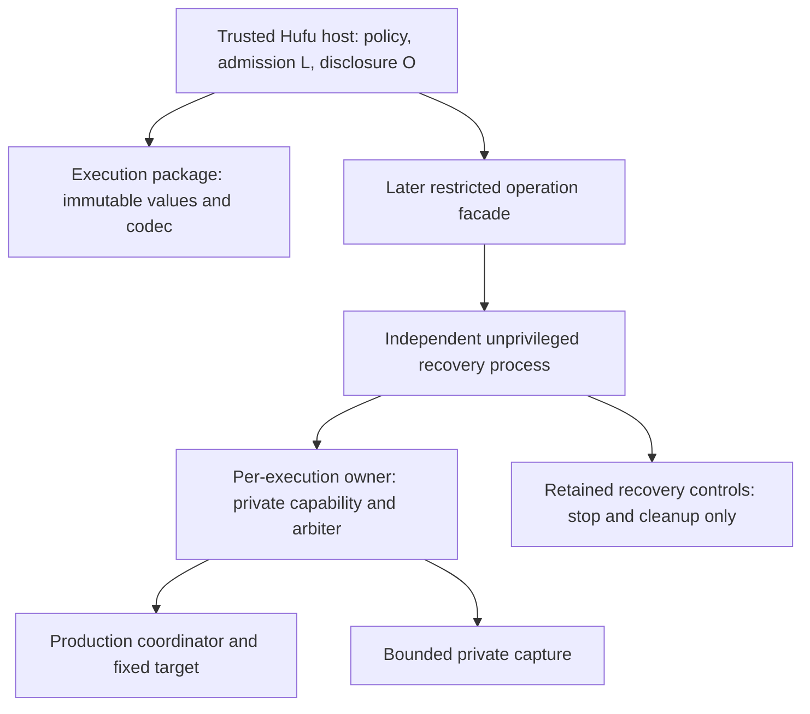

# RC-1: Restricted execution consumer contract

Date: 2026-10-24 (Asia/Manila). Author role: Gagamba architecture/API owner.
Status: **RC-1 DESIGN READY WITH QUALIFICATIONS**; proposed contract, pending
independent GLM review and owner acceptance. No implementation authorization.

This resolves the *design question* behind Hufu **AE4-B01**. It does not close
that blocker: an independently accepted RC-2A artifact is still required for
AE4-D4a, and a separately commissioned/qualified RC-2B is required for D4b.

The [implementation work orders](../plans/restricted-consumer-contract-implementation.md),
[review handoff](../reviews/restricted-consumer-contract-rc1-handoff.md) and
[source evidence](../evidence/restricted-consumer-contract-rc1/README.md) are part
of this proposal. Names in API sketches below are **proposed**, not existing symbols.

## 1. Verified starting point and capability inventory

Selected parent: `629a08d2ee82a9ac084d87ed73ad8d584661ea28` (local C1 producer
evidence tip). Source tree `9dd0f055eaf48d48bda8683dee3f8dc534a06e5d`; tests tree
`ebcb976a164b212090fbe0958fe4b0c0b243f794`. The local worktree/ref inventory and a
fresh `git ls-remote --heads origin` were inspected. No later C1 review or C3/C4
implementation branch was present in those inventories. C1 was not advertised
on origin. Remote main was `8dea7d86c8ee2f1c924100acdbc1bf5dc14b2a88`, not the
restricted development baseline. This is an inventory observation, not a claim
about inaccessible repositories or future updates. Existing worktrees remain intact.

Hufu was inspected at `37dcf33362e8e745800a530a478fd406795c3e58`, including the
earlier design `236948509ee2e608e2e9a8461fabc379e037b65b`, stage register,
implementation plan, A01–A03 amendments and AE4-B01 entry report. Hufu remains
unchanged. Its optional Sandbox targets net10.0 and pins
`Gagamba.Runtime [0.1.0-preview.4]`.

| Existing component | Classification and reusable behavior | Boundary missing today |
|---|---|---|
| `Gagamba.Execution/Restricted/RestrictedManifest.cs` | Internal immutable values; schema 1; one canonical binary encoder and SHA-256 implementation | Public immutable inspection, strict binary decoder and compatibility API |
| `RestrictedTransaction.cs` | Internal outcome/capture/cleanup vocabulary | Consumer projections with provenance, stop acknowledgement and independent uncertainty axes |
| `PreparedTransaction` / `PreparationStore` | Internal live capability, private constructor, issuer/generation/reference checks; retained copied closure | Public data correlation, never public mint/consume/borrow |
| `OwnerPreparationTransaction`, `OwnerManifestWire` | Internal staging/manifest JSON transport and held-owner exchange | Supported consumer lifecycle; private JSON is not the canonical binary codec or a public authorization hook |
| `ReleaseArbiter`, journal, recovery classifiers | C1/C2 implementation, one-attempt arbitration and conservative recovery | Accepted C1 review, C4/C3 implementation, actual owner integration |
| `M1RecoveryScope` | Internal unprivileged subreaper, owner pidfd and retained domain/staging handles | Independently surviving consumer bootstrap, authenticated lifeline and stop-only reconnect |
| Public `IExecutionProvider` | Lifecycle negotiation, prepare, launch, termination and completion | Cannot express restricted admission or serve as this facade |
| Native fixture / WP05 coordinators / reference encoder | Qualification-only tools and independent byte oracle | Never production provider dependencies or a release path |

C2 preservation `6a60d2fc490acee18aa161b847a34343144c5b26` contains independently
reviewed WSL2 component evidence (producer `d4e8bf88ce1661717537aaa3fb392bfe24c04466`,
review `89464f5f214615ba94051e438d9b4979483ae5bf`). C1 has producer evidence only
at this baseline. D6.7 `01063c164391e0676ae1f6087d2c0865f7692511` approved C1–C4
and selected **C3 Policy A**. RC-1 neither reopens these decisions nor accepts
their implementations. WP06–WP09 composition, G3, WP10, WP11/G4 and WP12/G5 remain gates.

## 2. Selected separation

**RC-1A / RC-2A:** passive, portable, immutable value inspection and a supported
canonical codec in the existing `Gagamba.Execution` assembly/package. It can
inspect evidence on Windows without claiming Windows can execute the profile.
Parsing bytes confers neither provider provenance nor establishment nor authority.

**RC-1B / RC-2B:** a distinct restricted control facade, implemented later by
Gagamba over its real owner/runtime. The facade retains live authority internally;
the trusted host receives an operation object that only invokes checked admission,
stop and observation. No public operation reconstructs it from identifiers.



Gagamba has no Hufu, Cedar, SQLite authority-store, workflow or approval-engine
dependency. Hufu may authorize a prepared execution; it cannot assert provider
resource readiness, supply a release frame, or turn a digest into native authority.

## RC-D01 — Ownership and API scope

**Current:** `Gagamba.Execution` is already a packable net10.0 contract assembly.
`Gagamba.Runtime` references it plus the three lifecycle provider assemblies.
Linux M1 and its owner are non-packable net10.0 projects. Restricted values are
internal to Execution, shared with M1 through existing internal visibility.

**Decision:** add a small public namespace `Gagamba.Execution.Restricted.Contracts`
in Execution. Use sealed, get-only projections over the existing immutable model,
not accessibility changes to all existing records. Keep `ManifestCodec` the sole
production encoder. Add its strict reader there and expose a thin public entry.
The public projection contains no second mutable manifest model and no encoder.
Internally produced views must pass the same public validation as decoded views.

RC-2A exposes inspection, encode/decode, digest, schema support and passive
preparation correlation only. It does **not** ship the RC-1B control interfaces,
provider registration, bootstrap, native packaging, result observers or dummy
implementations. RC-1B sketches are specifications for a subsequent reviewable slice.

**Alternatives:** making existing records public freezes implementation details
and weak constructor checks; a new contract package adds no demonstrated benefit;
Hufu reflection, friend access or copied binary code is rejected. A public manifest
builder is unnecessary for D4a and deferred. Tests can use Gagamba-owned vectors.

**Risk:** projection drift; require exhaustive field mapping and one validation
path. Public data is not trusted merely because its type comes from Gagamba.
**Files:** Execution restricted model, new `Restricted/Contracts/` projections and
codec entry; Execution public tests; existing M1 contract tests. **Tests:** T01–T10,
T12, T15–T17 below.

## RC-D02 — Exact immutable inspection surface

**Current:** schema 1 has seven top-level fields. Qualification tags mean
`Mandatory=0` and `PendingQualification=1`, not Verified/Qualified. Some
constructors enforce M1 constraints; others accept values requiring later profile
validation (e.g. `NoNewPrivs=false`, empty inventories and unspecified enum casts).
Constructor success alone is therefore not restricted-profile acceptance.

**Decision:** the public `RestrictedManifestView` exposes the following complete
tree. Nested names end in `View`; names/types listed below are normative property
contracts. `u64=ulong`, `u32=uint`, `u16=ushort`. All lists are immutable snapshots,
all strings are immutable, all digests are immutable 32-byte values; no returned
array aliases internal storage. No setters, `init` setters, record `with` mutation,
arbitrary JSON constructors or factories for a live prepared object.

| Public subtree | Every inspectable field, with types |
|---|---|
| Root | `SchemaVersion:u16`, `ImplementationId:string`, `Authority`, `Resources`, `Closure`, `Invocation`, `Channels` |
| Authority | `Namespaces:list<string>`, `Capabilities:list<string>`, `NoNewPrivs:bool`, `FilterSha256:digest`, `FilterLength:u64`, `ReadOnlyDestinations:list<string>`, `WritableStores:list<store>`, `NoAmbientEnvironment:bool`, `NoIpcEndpoints:bool`, `NoExtraInheritedFds:bool`, `MountPolicy`, `NetworkQualification:qualification` |
| Writable store | `Path:string`, `Bytes:u64`, `HasInodeBudget:bool`, `InodeBudget:u64` |
| Mount policy | `ToolExecutable:bool`, `ScratchNoexec:bool` |
| Resources (each is a budget) | `Memory`, `Swap`, `Tasks`, `FileDescriptors`, `TmpBytes`, `ShmBytes`, `StdoutBytes`, `StderrBytes`, `CaptureAggregateBytes`, `SetupTimeoutNs`, `OverallTimeoutNs`, `StopAllowanceNs`, `FinalDrainNs` |
| Budget | `Kind:Absent=0/Exact=1/Unlimited=2`, `Value:u64`, `Unit:string`, `Qualification:Mandatory=0/PendingQualification=1` |
| Other resources | `InodeQualification:qualification`, `CoreDumps`, `OwnerAllocation` |
| Core dumps | `CoreDisabled:bool`, `RuntimeDumpsDisabled:bool`, `CorePatternObserved:string?` |
| Owner allocation | `StagingBytes:u64`, `StagingObjects:u32`, `ConfigBytes:u64`, `CoordinatorStatusBytes:u64`, `HelperStatusBytes:u64`, `JournalBytes:u64`, `ReceiptBytes:u64` |
| Closure | `Objects:list<object>`, `HelperDependencies:list<string>` |
| Closure object | `Role:string`, `Sha256:digest`, `Length:u64`, `Destination:string`, `BuildIdentity:string` |
| Invocation | `ToolPath:string`, `Mode:string`, `InputPath:string`, `Argv:list<string>`, `Environment:list<KeyValuePair<string,string>>`, `WorkDirectory:string` |
| Channels | `StdinEof:bool`, `StdoutLimitBytes:u64`, `StderrLimitBytes:u64`, `AggregateLimitBytes:u64` |

The root's implementation ID is exactly `linux-m1-native-transaction`; schema 1
does not contain a provider package version, build hash, preparation UUID or live
readback. Do not add these to schema 1 or pretend they affect its digest. They
belong to separate provider/correlation/evidence objects (D04/D07).

Private forever at this boundary: store entries, `PreparedTransaction`, mint and
consume methods, retained file descriptors, device/inode control handles, release
pipe/frame, writer leases, owner sockets, source/staging paths, test barriers,
`ReleasePrerequisites`, coordinator control and raw recovery authorities. Selected
object identities and diagnostics can be disclosed as bounded facts, never handles.

The parsed manifest is a **description**, including any recorded observational
fields such as core pattern and scratch policy. Only a later provider-origin
`PreparedRestrictedExecution` can associate it with preparation. A separate
establishment report has `Absent`, `Observed`, or `Unknown`, a preparation
reference, evidence version, observation provenance and per-constraint readbacks.
Neither `Mandatory` nor `Observed` promotes a pending production qualification.
RC-2A supplies no API that turns a parsed manifest into establishment evidence.

**Alternatives:** returning JSON/dictionaries loses exhaustive typing; copying all
public values into a second encoder risks split identity. Exposing only a hash
prevents policy inspection. **Risks:** confusing a requested flag with enforcement,
or treating an empty collection as absent. Preserve all distinctions. **Files:**
existing model; public views; later provider observation mapping. **Tests:**
T01–T03, T06–T08, T10, T14–T16.

## RC-D03 — Authoritative codec, validation and compatibility

**Current:** `ManifestCodec.Encode` writes schema 1, with a SHA-256 helper.
There is no binary decoder in that class. `OwnerManifestWire` is separate private
JSON transport, not a public binary decoder. Existing independent reference
encoder and literal golden bytes are test oracles, not production codec copies.

**Selected RC-2A surface** (signature sketch, no implementation here):

```csharp
public static class RestrictedManifestCodec
{
    public const ushort SupportedSchemaVersion = 1;
    public const int MaxCanonicalBytes = 65536;
    public static bool Supports(ushort schemaVersion, string implementationId);
    public static ManifestDecodeResult Decode(ReadOnlySpan<byte> canonicalBytes);
    public static byte[] Encode(RestrictedManifestView manifest);
    public static ImmutableArray<byte> ComputeSha256(RestrictedManifestView manifest);
    public static bool VerifySha256(RestrictedManifestView manifest,
                                   ReadOnlySpan<byte> expectedSha256);
}
```

`ManifestDecodeResult` is a sealed discriminated result: either one validated
view or one closed error code and byte offset, never both. Codes: `EmptyInput`,
`InputTooLarge`, `UnsupportedSchema`, `UnsupportedImplementation`, `Truncated`,
`InvalidLengthOrCount`, `InvalidUtf8`, `InvalidTag`, `InvalidValue`,
`NonCanonicalOrder`, `Duplicate`, `TrailingData`. Errors never echo arbitrary
input strings. Null API arguments are programming errors; malformed bytes return
a refusal, not a partial view. Digest comparison requires exactly 32 bytes and
uses a constant-time byte comparison. SHA-256 is identity, not authentication.

### Schema 1 exact byte grammar

No magic prefix, BOM, terminator, padding, metadata envelope or digest suffix.
Integers are fixed-width unsigned little-endian. `S` is u32 byte length plus strict
UTF-8 bytes, without Unicode normalization. `D` is exactly 32 raw bytes. `B` is
exactly one byte 0 or 1. `Q` is one byte 0 or 1. A list is u32 count followed by
that many items. Order below is normative and matches the existing encoder.

| Segment | Ordered encoding |
|---|---|
| Root | u16 schema; S implementation; Authority; Resources; Closure; Invocation; Channels |
| Authority | list S namespaces; list S capabilities; B noNewPrivs; D filter; u64 filterLength; list S readonly; list Store; B noAmbientEnvironment; B noIpcEndpoints; B noExtraInheritedFds; B toolExecutable; B scratchNoexec; Q network |
| Store | S path; u64 bytes; B hasInodeBudget; u64 inodeBudget |
| Budget | byte kind (0/1/2); u64 value; S unit; Q qualification |
| Resources | 13 budgets in the D02 table order; Q inode; B coreDisabled; B runtimeDumpsDisabled; B corePatternPresent; S corePattern only when present; u64 stagingBytes; u32 stagingObjects; u64 config; u64 coordinatorStatus; u64 helperStatus; u64 journal; u64 receipt |
| Closure | list Object; list S helperDependencies |
| Object | S role; D hash; u64 length; S destination; S buildIdentity |
| Invocation | S tool; S mode; S input; list S argv; list (S key,S value) environment; S workDirectory |
| Channels | B stdinEof; u64 stdout; u64 stderr; u64 aggregate |

The manifest has **no UUID bytes**. Existing RFC 4122 Guid conversion applies
where identity/protocols use UUIDs, not to this binary grammar.

Canonical ordered sets use unsigned UTF-8 byte ordering, not UTF-16 ordinal or
culture ordering: namespaces, readonly destinations, helper dependencies; stores
by path, closure by role, environment by key. Duplicates refuse. Capabilities
must be empty in schema 1. Argv order is preserved; repeated arguments are allowed.

### Validation layers and resource bounds

1. Reject more than 65,536 input bytes *before allocation*. This is a new public
   codec transport ceiling, not a claim that the internal encoder previously had
   that ceiling or that the 16-KiB owner configuration admits that much data.
   The profile and owner may impose stricter bounds. No caller can raise this cap.
2. Read with a checked cursor. Check lengths against remaining bytes and counts
   against the minimum remaining encoded item size before allocating. No allocation
   follows an untrusted u32 directly. The grammar has fixed nesting, no recursion.
3. Reject unknown version/implementation, unknown enum values, non-0/1 booleans
   or presence tags, invalid UTF-8 (including overlong sequences and surrogates),
   truncated input, overflow, trailing data, duplicates and unsorted wire sets.
   Do not sort untrusted wire input into acceptance.
4. Apply existing model invariants: required strings nonempty; non-null required
   collections/elements; 32-byte digests; empty capabilities; required ambient
   denials; tool executable; network/inode qualification Pending; fixed paths
   `/tool`, `/input`, `/tmp`; stdin EOF; core disabled; present core pattern
   nonempty; absent/unlimited budgets carry value zero; absent inode budget
   carries zero; argv/env UTF-8 sum at most 16,384 bytes. Empty environment values
   are allowed; empty argv items are not. Empty argv/inventories are structurally
   representable where current constructors allow them, but not necessarily
   executable. Required strings must be strict-UTF-8 encodable on every route.
5. Build the existing immutable internal values, then re-encode with the one
   authoritative encoder and require byte equality. This is defense in depth,
   not a replacement for pre-allocation validation. Projection and parser use
   the same shared canonical validation. Public encoding also validates its view.

Structural decoding does not invent profile rules: it does not silently change
`NoNewPrivs`, units, paths, empty sets, embedded NUL/control characters or resource
consistency. A native profile must reject illegal OS strings and mismatched or
missing required facts. The strict reader newly rejects undefined enum values
that some internal constructors can currently carry. Do not silently widen those
values into a supported schema. RC-2A must preserve existing valid golden bytes
and disclose any newly rejected internal test input; it must not alter arbitration.

### Compatibility and test vectors

`Encode(Decode(b).Value) == b` for every accepted byte sequence.
`Decode(Encode(v))` preserves every field for an accepted view. Equivalent internal
construction permutations yield the same bytes; altered semantic field values
yield altered bytes (and tested SHA-256 identities, assuming hash collision resistance).
Reordering argv is a change; reordering a set before canonical construction is not.

Only schema 1 and its exact implementation ID are supported initially. Unknown
versions refuse; no best-effort decoding, dropping fields or implicit migration.
Adding a field or changing byte meaning requires a new schema and independent
vectors. A package patch may fix rejection bugs but cannot redefine accepted
schema-1 bytes. Migration, if later commissioned, creates a new description and
requires fresh provider preparation/host authorization; it never migrates a live
capability or silently changes an already approved manifest digest.

The existing `Contracts/ManifestTests.cs` literal golden has SHA-256
`82161029848b1a821241af112ca806be8029d3cf2e7b95c6b23ce3e35850d5f3`.
Its `app` closure and argv are a **codec fixture**, not the AE-4 execution profile.
Retain its independent `ReferenceEncoder.cs` comparison. RC-2A exports documented
vectors (hex, expected values, digest, source) for portable consumers, adding
UTF-8 supplementary-plane ordering, null core pattern, empty env value, exact
zero/absent/unlimited, max input and malformed cases. Hufu consumes vectors and
the library, never the reference encoder implementation.

**Alternatives:** JSON canonicalization or a Hufu codec changes identity; a
lenient decoder creates ambiguous inputs; no decoder forces forbidden copying.
**Risk:** allocation denial, tightening valid semantics, or treating a parsed
description as safe. **Files:** original codec/shared validator, public entry,
new reader, golden data/public tests, existing reference tests. **Tests:** T01–T06,
T12, T15–T17. No native execution is required.

## RC-D04 — Preparation, provider and artifact identity

**Current:** `PreparationIdentity` holds four nonempty GUIDs and a manifest
digest. The store requires the minted object's reference plus issuer/generation,
digest, expiry and unused state. It retains the verified closure's actual handles.
The digest does not bind arbitrary source revision strings outside the manifest.

**Decision:** RC-2A exposes a passive sealed `RestrictedPreparationReference`
with `ExecutionId`, `IssuerId`, `GenerationId`, `PreparationId`, and
`ManifestSha256`. A validating public constructor may copy these values from
evidence (including test evidence). Empty GUIDs/wrong digest length refuse.
Value equality compares contents, not collection object references. This type has
no lookup, release, adoption, deserialization-to-capability or expiry-renewal method.

RC-2B provides `PreparedRestrictedExecution`, created only by its live operation,
containing that reference, manifest view, exact provider descriptor, original
deadline set and establishment evidence. A release request supplies the same
prepared view object to the same operation. Internally, both the local object
association and the complete retained identity are checked, followed by owner
store/arbiter checks. No public `Prepare(manifest)` trusts parsed values as an
already prepared closure. Caller sources are independently copied/hashed/opened
under the accepted profile before minting, and subsequently cannot be substituted.

Provider descriptor, version 1 (later facade value): `ProviderId`,
`ImplementationId`, `ContractPackageId`, `ContractPackageVersion`,
`ProviderPackageId`, `ProviderPackageVersion`, `SourceCommit`, `SourceTree`,
`RuntimeIdentifier`, `ManifestSchemaVersion`, `OwnerProtocolVersion`,
`CoordinatorProtocolVersion`, `Artifacts`, `Qualification`. Artifacts are a closed,
sorted role inventory of `Role`, `Sha256`, `Length`, `BuildIdentity`. Include actual
managed owner/provider/recovery process, production coordinator, filter,
Bubblewrap/helper and its loader/shared-library closure as applicable. Runtime
artifact IDs/hashes, not just informational version strings, must match an
independently accepted local deployment inventory. No claimed package identity
is invented for today's non-packable M1 projects.

The complete descriptor is captured once per operation and checked against
deployment pins and the live owner handshake before preparation/release. The
manifest's closure and filter facts must agree with the copied target/input and
selected native artifacts. Missing/extra dependencies refuse. Trust is protected
installation plus the authenticated live channel; a parsed descriptor or Git hash
alone is not attestation. This metadata is compared field by field and is not
silently appended to the schema-1 digest. Hufu's separate approval binding includes it.

Original deadlines: `AcceptedAtNs`, `PreparationExpiresAtNs`, `SetupDeadlineNs`,
`OverallDeadlineNs`, plus corroborated `ClockId`, `BootId`, `EpochId`, `FrequencyHz`
and generation. Positive values and checked arithmetic; acceptance precedes all
deadlines, setup is **strictly before** overall (current arbiter requirement), and
release precedes the earliest expiry/setup/overall cutoff. Consumer UTC validity
never substitutes for these native monotonic deadlines. Values are echoes to
compare, not knobs to extend. C3 selects the production clock implementation.

**Alternatives:** digest-only identity loses exact live association; public
capability serialization restores authority improperly; hashing build metadata
into v1 breaks existing bytes. **Risks:** TOCTOU, reused IDs, stale generations,
same version/different binary. **Files:** public passive reference (2A); store,
owner protocol, bootstrap, provider descriptor and admission (2B). **Tests:**
T03, T07–T09, T13, T18–T21; native counterparts later.

## RC-D05 — External authorization and control facade

**Current:** private `OwnerManifestAuthorization` is an internal preparation
exchange, not host policy authorization. Hufu's design uses real ExecuteProcess
for the executable and ReadFile for protected input/output, its admission point
L and an original-controller-only volatile dispatch latch. None exists in Gagamba.

**Decision:** a trusted host authorizes the immutable prepared view, then invokes
the checked operation once. Gagamba validates identity, liveness, original deadlines,
actual prerequisites and arbitration, not Hufu policy. Host evidence failures,
expired authority, revoked admission and ambiguous admission do not create a call.
No untrusted plugin or target can access the control object or its authenticated
session. This API is not a security boundary against arbitrary code in its host process.

An optional `ApprovalCorrelationSha256` (absent or exactly 32 bytes) binds the
host's separate canonical approval record for audit. Hufu requires it; generic
Gagamba hosts need not use it. It cannot grant release, supply readiness or enlarge
the manifest. The owner associates the first admitted correlation with its live
operation; it never accepts a replacement. This check must preserve C4: after a
decision is retained on the same operation, return Duplicate with the original
decision/correlation and a separate binding-mismatch diagnostic, not a new arbiter
Refused result. Before retention, a mismatch refuses admission without a second
attempt. Do not serialize all callers or add a waiter to enforce correlation.
Gagamba does not parse/store Hufu's 24-KiB approval record or fetch its
authority store. It reports whether this correlation was durably retained; lost
correlation persistence is not claimed as durable authorization. No new WP05
journal field is authorized here; any later durable envelope needs its own version
and source-bound RC-2B review, without changing C1–C4 semantics.

### Later control interface (semantic sketch)

```csharp
public interface IRestrictedExecutionProvider
{
    RestrictedProviderDescriptor Describe();
    RestrictedOperationCreation CreateOperation(RestrictedProfileSelection selection);
    ValueTask<RestrictedInspection> InspectExecutionAsync(
        RestrictedPreparationReference reference, CancellationToken waitCancellation);
    ValueTask<RestrictedReconciliation> ReconcileAsync(
        RestrictedPreparationReference reference, CancellationToken waitCancellation);
}

// Sealed provider-created object; private/internal constructor, no public factory.
public sealed class RestrictedExecutionOperation : IAsyncDisposable
{
    public ValueTask<RestrictedPrepareResult> PrepareAsync(
        RestrictedPreparationInputs inputs, CancellationToken waitCancellation);
    public ValueTask<RestrictedReleaseReply> RequestReleaseAsync(
        PreparedRestrictedExecution exactPreparation,
        ImmutableArray<byte> approvalCorrelationSha256,
        CancellationToken waitCancellation);
    public ValueTask<RestrictedStopReply> RequestStopAsync(
        RestrictedStopReason reason, CancellationToken waitCancellation);
    public ValueTask<RestrictedObservation> ObserveAsync(
        ulong afterSequence, CancellationToken waitCancellation);
    public ValueTask<RestrictedCaptureRead> ReadProtectedCaptureAsync(
        RestrictedCaptureReadRequest boundedRequest, CancellationToken waitCancellation);
}
```

`RestrictedProfileSelection` is a trusted installed profile identity/version and
exact artifact pins, not arbitrary executable arguments or a public experimental
bypass boolean. `RestrictedPreparationInputs` selects protected enrolled sources;
it cannot supply readiness facts, native handles, internal manifests or test paths.
`CreateOperation` returns a bounded in-memory control reservation before domain,
staging or owner allocation. Unsupported selection returns refusal with no setup.
`PrepareAsync` is at most once, accepts the original provider time origin before
setup, and returns Held/prepared evidence without any target initializer executing.

Stop can be submitted before/during preparation. A provider-local pending stop
immediately inhibits future release on that operation. This is distinguished from
**owner runtime acceptance**, where C2 consumes an issued capability. Once stop
wins before any capability exists, preparation must not mint a releasable one.
All stages observe the same stop obligation. Stop delivery is independent of a
blocked host DB call, observer or capture reader. Token cancellation cancels a
wait, not the operation or the stop obligation; use RequestStop for safety stop.
Lost release/stop replies mean observation loss, never permission to retry release.

Observation is bounded latest-state pull, with monotonic sequence and explicit
gap/loss reporting; a slow subscriber cannot block drains/stop or create an
unbounded queue. Terminal execution records are immutable; subsequent cleanup
reports append separately. Capture reads select stdout/stderr plus checked
offset/count, bounded by retained quotas and a per-call 16-KiB ceiling, returning
copied bytes only to the trusted host. No target path, raw descriptor or arbitrary
filesystem read. Native drains enforce per-stream/aggregate limits independently
of readers. Hufu places bytes in its protected output custody and performs its
own current ReadFile/O admission before external disclosure. Gagamba never claims
that disclosure happened. Disposal closes the session and requests stop; it does
not assert cleanup success or erase unresolved obligations.

The optional correlation argument uses a default/empty immutable array for absent
and exactly 32 bytes for present; other lengths are invalid. Absence is never
equivalent to an all-zero digest. These are API argument semantics, not a new
canonical manifest field. Replies preserve the retained correlation and report
request-binding errors separately from retained execution facts.

### Process and recovery contract to implement in RC-2B

The trusted installation bootstrap starts one **unprivileged Gagamba recovery
process** outside the controller's lifetime and outside every target domain.
That process owns `M1RecoveryScope`, enables subreaping, opens the delegated parent
and spawns/retains the per-execution owner. This is a new supported deployment of
the existing class, not a claim that a standalone recovery executable exists now.
The controller can exit without the recovery process being killed by the same
job/cgroup/session supervisor. RC-2B must refuse deployments that cannot establish
and qualify that independence; it must not provision privilege to obtain it.

| Holder | Retained controls and authenticated channels | Loss behavior |
|---|---|---|
| Controller/host | Non-inherited live controller endpoint and operation object; host policy/expiry monitor | Endpoint EOF/death triggers surviving scope safety stop. Reconnect can inspect/stop/reconcile, never release |
| Recovery process | Delegated parent, retained domain/staging handles, owner pidfd, subreaper, journal takeover authority after proven owner exit | Owner observes recovery-lifeline loss and stops; no simultaneous writer takeover while owner lives |
| Per-execution owner | Preparation store/capability, journal writer, actual resource/capture readiness and sole release writer | Recovery stops retained domain and reconciles after proving owner exit; never remints or resends |
| Coordinator | Private release reader/status writer and trusted root reaping/error observations | Owner preserves missing/unknown status and stops whole domain |
| Target | Only admitted input/closure and FDs 0–2 | Never inherits controller, recovery, journal or release controls |

Initial controller association uses a protected local endpoint, expected OS peer
identity and a bootstrap-created random session secret transferred only over an
inherited/private protected channel. Do not send it in argv, environment, journal
or target-visible storage. The scope records one release-capable controller
generation in live memory. Read/stop reconnect authenticates the protected
installation endpoint and OS identity but cannot recreate that generation/secret
or receive release admission. Same-UID hostile host code/admins remain outside the
M1 trust model; the secret is defense against accidental cross-session access,
not a claim of same-UID isolation. Transport and secret handling require their
own RC-2B security review and negative native tests.

The controller lifeline and safety-stop path are independent of observation and
bulk capture traffic. A hung host call does not disable Hufu's independent expiry
monitor; its monitor failure closes/inhibits admission and signals stop. Controller
death destroys that monitor, hence the scope lifeline obligation. Reconnecting
does not reset provider deadlines or restore the host dispatch latch. If every
live native holder is lost, inspection returns available evidence with Unknown;
reconciliation refuses destructive control based only on paths/PIDs/IDs. Quarantine
is the host's disposition. No privileged service or disk-only adoption is proposed.

**Alternatives:** expose the owner message/capability (authority leak), callback
under the release lock (deadlock/policy coupling), embed Hufu policy (dependency
violation), or return a reconstructed release token (replay). **Risks:** process
death topology, lifeline backpressure, return/ACK loss, capture custody and locks.
**Files:** later facade/runtime registration, owner protocol/transaction, scope
bootstrap/lifelines, capture/recovery. **Tests:** T07–T14, T18–T23. These are RC-2B
obligations, not hidden prerequisites for implementing the passive RC-2A codec.

## RC-D06 — Preserve C1–C4 exactly

**Current:** C2 and C1 code exist; C1 independent implementation review is pending.
C3/C4 are approved contracts with separate implementation gates. In particular,
current `Reconciler` still passes `_stopAllowance` to `StopAndAwaitEmpty`; it must
not be advertised as the approved durable-deadline C3 implementation.

| Contract | Required facade semantics |
|---|---|
| C2 | First owner runtime stop acceptance irreversibly consumes the live release capability, including clock-unavailable and overflow paths. Duplicate stop retains first cause/deadline and does not consume again. Failed StopRecord persistence never restores authority. Local request queued is a separate fact |
| C1 | Typed ambiguous post-content ReleaseIntent persistence is `MayHaveExecuted`. Ambiguity retained first yields `AmbiguousPersistence`; stop retained first yields `Refused(MayHaveExecuted)`; existing retained decision yields `Duplicate`. Tail stop occurs after journal/runtime locks are released. Local `Delivery.NotAttempted` and `LiveExecutionExcluded=true` may coexist with conservative durable ambiguity |
| C4 | Sequential call after retained decision is Duplicate; concurrent loser may be Refused while another caller releases. No ConcurrentRefusal kind, waiting/notification protocol or lock-based reinterpretation. Refused is not global no-execution evidence; Duplicate is not durable-commit evidence. At most one physical RELEASE |
| C3 | Original sealed/corroborated durable absolute StopRecord deadline is authoritative. Validate boot, epoch, frequency and live identity. Policy A on valid expiry: existing identity-checked kill plus one immediate population observation, no renewed wait. No valid StopRecord means no fabricated deadline or allowance. Known failure remains Failed; persistence-only uncertainty remains Unknown; Refused is separate. Journal finalization is independent |

Do not add an automatic resend/reprepare loop at the facade. An explicit later
caller invocation observes the arbiter's permitted duplicate/refusal semantics;
it does not cause a second physical release. Failed/ambiguous persistence never
reconstitutes capability. Recovery can improve separately supported evidence,
not erase historical ambiguity or treat cleanup as proof no target ran.

**Alternatives:** collapsing duplicates/refusals or waiting for the winner breaks
C4; restarting deadlines breaks C3; returning NotCommitted for ambiguous seal
breaks C1. **Risks:** a convenience adapter can erase correct internal distinctions.
**Files:** later facade mappings and conformance tests; existing arbiter/journal
and independently commissioned C3/C4 implementation. **Tests:** T08–T09, T14,
T18–T21 plus exact existing C1/C2/C3/C4 approved inventories. No C semantic change in 2A.

## RC-D07 — Result, evidence and uncertainty

**Current:** internal result vocabularies are a useful base, but a single
`TransactionObservation` does not include every delivery/stop/finalization fact
needed externally. Several record constructors are storage shapes, not complete
cross-field validation. Do not merely make them public.

**Decision:** later immutable provider-origin observations carry evidence version,
sequence, preparation reference, provenance (live owner/durable journal/recovery),
and independent optional axes. Unknown/missing is never enum zero by default.

| Axis | Public facts / invariants |
|---|---|
| Release reply | Kind: Refused, Released, Duplicate, Stopped, AmbiguousPersistence; retained decision versus this call's disposition; bounded reason code |
| Request binding | Accepted / Mismatch / Invalid argument, original retained approval correlation and bounded mismatch diagnostic; cannot overwrite retained C4 Duplicate/decision facts |
| Release evidence | NotCommitted / Committed / MayHaveExecuted; durable-intent/commit evidence and any persistence ambiguity; live-execution-excluded is a distinct scoped observation |
| Delivery | NotAttempted / Delivered / WouldBlock / BrokenPipe / Partial / Unknown. Delivered means full owner write, not coordinator consumption or exec |
| Exec | NotAttempted / FailedBeforeExec with trusted errno / Confirmed with trusted basis / Unknown |
| Outcome | Unsupported / FailedToEstablish / CancelledBeforeRelease / Succeeded / TargetFailed / Stopped / Unknown; no outcome yet while nonterminal |
| Root and helper | Separate Unknown / NotStarted / Exited(exitCode,rawWaitStatus) / Signalled(signal,coreDumped,rawWaitStatus). A wrapper's 128+signal is not target signal proof |
| Stop submission | LocallyQueued / RuntimeAccepted / Refused / Unknown; duplicate flag, first reason, release-already-committed, original acceptance/deadline when known; durable stop confirmed or uncertain separately |
| Stop completion | NotObserved / Confirmed / Failed / Unknown / Refused, with typed operation failure distinct from journal finalization |
| Domain | Empty / Populated / Unknown, with live/retained-handle evidence and observation time; empty does not imply reaped or cleaned |
| Capture | Per-stream and total stored/observed bytes, overflow, read failure, truncation, EOF, completeness, final drain Complete/Incomplete/Expired; absent capture is not complete empty capture |
| Cleanup | Confirmed / Failed / Unknown, separate domain-empty, reaped, staging-removed and journal-finalized components. Confirmed requires all mandatory components and durable finalization confirmed |
| Journal finalization | Confirmed / Failed / Unknown / Refused, with no fabricated operation failure for persistence-only uncertainty |

Validate tagged payloads: exit code exists only for Exited; errno only for known
exec failure; unavailable time is absent, never a valid zero deadline; stored byte
totals are consistent and bounded; terminal records cannot be overwritten by
later observations. Return bounded conflict diagnostics when evidence conflicts.
Unknown persisted fields remain Unknown after process disappearance. Even a
trusted zero target exit cannot alone establish successful restricted execution,
complete output or cleanup.

Preserve D6.3's independent population correction: if kill was NotAttempted but
an authorized retained-handle fallback observes Empty, domain emptiness may be
Confirmed while DomainStop remains Unknown; the aggregate remains quarantined
Unknown. A known operation failure has precedence over persistence uncertainty.
If only durable finalization is unconfirmed, otherwise successful operations do
not become Failed or Confirmed cleanup. Refused recovery authority stays explicit
in the reconciliation result, without inventing cleanup failure.

Gagamba reports native/capture facts. Hufu separately reports current authorization,
admission persistence, output O/disclosure/acknowledgement and quarantine. No
`Authorized`, `OutputDisclosed` or Hufu approval result appears in Gagamba's outcome.

**Alternatives:** one Success bool or exception-only reporting loses recoverable
facts. **Risk:** false success through default values or omission. **Files:** later
public result projections, observation/receipt mappings and validation; internal
vocabulary remains private. **Tests:** T10, T14, T18–T23. These public result types
are RC-2B, not unnecessary extra API in RC-2A.

## RC-D08 — Restricted admission is a separate provider contract

**Current:** `IExecutionProvider` exposes lifecycle capabilities; runtime selection
chooses Windows/Linux/macOS lifecycle providers. It has no equivalent confinement
manifest, establishment or one-shot restricted release boundary.

**Decision:** selection for `IRestrictedExecutionProvider` is separate, default
disabled and unavailable until its exact profile/artifact/host has passed the
required gates. No inheritance from `IExecutionProvider`, no Launch adapter and
no fallback. Unsupported OS/RID, profile, mandatory qualification or missing
mechanism refuses before target initialization (preferably before any setup).
Windows/macOS can parse RC-2A values but cannot advertise this Linux profile.

Production `restricted-offline-closure-v1` continues to refuse while mandatory
production qualifications are pending. A separately authorized fixed-fixture
experimental registration names its exact bounded scope. No request-controlled
`allowUnqualified=true`, environment override or test-coordinator path can select it.
The trusted host must install the reviewed Gagamba implementation; arbitrary code
can implement a .NET interface, so type conformance alone is not attestation.

**Alternatives:** add restricted flags to Launch (false equivalence), or claim
an experimental enum waives OS gates (unsupported). **Risks:** accidental provider
selection, test artifacts in deployment. **Files:** later Runtime selection and
provider factory; public negative consumer tests now. **Tests:** T10–T13, T21.

## RC-D09 — Packages, native binding and clean consumers

**Current:** all relevant projects use net10.0; default package version is
0.1.0-preview.4. Execution is packable; Runtime pulls Execution and Windows/Linux/
macOS packages. M1 and Owner are not packable. SourceLink is a private build
dependency. The installed preview does not imply this proposed API exists.

**Decision:** RC-2A produces a **local-only** uniquely versioned candidate
`Gagamba.Execution`, net10.0, with the passive API. Use a prerelease version of the
form `0.1.0-rc2a.<full-40-character-implementation-commit>` via pack properties,
never overwrite preview.4 and never rely on NuGet build metadata to distinguish
artifacts. Record actual package SHA-256, DLL hash, nuspec dependencies, source/test
trees, SDK and exact commands. Pin the full version (not a floating range) in
consumer evidence. This naming is for local qualification, not a reserved release.

The package needs no M1, owner, native artifact, Hufu or policy-engine dependency.
Inspect the produced nuspec/assembly references; do not assume build dependencies
are runtime dependencies. Use only the existing TFM until separate compatibility
evidence supports others. RC-2A's portable binary parser performs no platform
probing, process start, native load or network operation.

Clean-consumer qualification: a temporary net10.0 project outside the checkout,
isolated NuGet cache/source configuration, exact local package reference, no
ProjectReference or friend access/reflection, offline local restore, all required
transitive artifacts explicitly supplied. Decode/re-encode/verify vectors and
negative cases; prove absence of public mint/release/native authority. The test
project must not acquire `Gagamba.Execution.Linux.M1.Tests`' identity or visibility.

Hufu's current Runtime preview dependency must not accidentally resolve a mixed
contract assembly. Before D4a, Sol must review an exact dependency graph: either
add a compatible exact Execution reference alongside the existing lifecycle
dependency and prove downgrade/assembly/API compatibility, or commission coherent
local Runtime/provider candidates from the accepted source. Do not silently
replace Hufu's package, suppress NuGet warnings or expand RC-2A into runtime work.
If neither graph can be validated without changes beyond the RC-2A scope, stop
and amend the packaging work order. The clean Execution-only consumer remains a
required gate but is not sufficient evidence for Hufu's mixed dependency graph.

RC-2B will need a separately reviewed deployment artifact manifest for the real
provider, owner, recovery process, coordinator, filter and helper closure; it must
pin protocol versions, source/build configuration and every selected binary hash.
Production `native/linux-m1/exec-coordinator.c` and protocol-test/WP05 fixture
coordinators are different artifacts. The bootstrap refuses missing, extra,
test-only, changed, wrong-RID or wrong-version components before preparation.
No current M1 NuGet package is invented and no automatic sibling-build fallback
is permitted. Decide distributable owner/native layout in its RC-2B commission;
that missing deployment implementation does not block passive codec work.

**Alternatives:** publish now (unauthorized), reuse preview.4 (ambiguous identity),
new package/TFM matrix (unjustified scope), ship test executables as runtime
(invalid provenance). **Risk:** package resolution differs from source references.
**Files:** RC-2A local pack/evidence and package smoke fixture; later M1/Owner/
Runtime packaging only under RC-2B authorization. **Tests:** T11–T13, T17, T21.

## 3. AE-4 first-profile clarifications and remaining parameters

Select **`Invocation.Mode = "work"`** as Gagamba's descriptive identifier for
the proposed fixed native fixture's default invocation. This is an explicit RC-1
owner proposal, not a claim that an allowlist already exists. The existing golden
uses `work`; the actual fixture selects default useful work by absence of `--fail`
or `--ctor-marker`. The mode label adds no argv item: argv is exactly `[/tool]`.
It prints fixed useful-work text and a constructor marker; it does not read input.
Acceptance of RC-1 must include this mapping before Hufu D4a relies on it.

For `ae4-linux-fixed-fixture-v1`, exact values remain the Hufu A02/M1 envelope:
namespaces `ipc,mount,net,pid,user,uts` in canonical order; empty capabilities;
no_new_privs true; all three ambient denials true; tool executable true; scratch
noexec false (no positive noexec claim); network/inode Pending; writable stores
`/dev/shm=1048576`, `/tmp=7340032`, no inode budget (false,0). All 13 budgets are
Exact/Mandatory: memory 134217728 bytes, swap 0 bytes, tasks 48 tasks, FDs 64 fds,
tmp/shm as above, stdout/stderr 65536 bytes, aggregate 131072 bytes; setup
10000000000 ns, overall 30000000000 ns, stop 5000000000 ns, drain 1000000000 ns.
Channels repeat those byte bounds and stdin EOF. Paths `/tool`, `/input`, `/tmp`;
environment exactly HOME=/tmp, LANG=C, TMPDIR=/tmp (canonical key order).
Owner allocations: 16777216 staging bytes, 128 objects, config/coordinator/helper
status 16384 each, journal 65536, receipt 32768. Core disabled true;
RuntimeDumpsDisabled=false records no general runtime-dump establishment for this
static-only profile. Production core-sink and runtime qualification remain separate.

The complete accepted descriptor must supply these **required pin parameters**:
`ProviderBuild` (D04 descriptor); `ClosureObjects` (exact sorted role/hash/length/
destination/build-identity tuples); `HelperDependencies` (closed exact inventory);
`ReadOnlyDestinations` (closed inventory including `/tool` and `/input`);
`FilterSha256`, `FilterLength`; `CorePatternObserved` and its separately qualified
host condition; `HostQualificationId` and its exact OS/RID/kernel/delegation scope.
Every source-backed prepared object must agree with those pins. No extra role,
destination, helper or flag is accepted. Input bytes/hash/length are the enrolled
input parameter (at most 262144 bytes); tool at most 4194304 bytes; remaining
artifacts and all arrays must obey profile, codec and owner configuration bounds.

These pins cannot truthfully be filled with future native artifact hashes today.
RC-2A supplies source-bound **synthetic** manifest vectors for D4a deterministic
matching, with the distinction explicit. D4a acceptance requires this complete
parameterized predicate plus the reviewed Mode mapping, not a real native launch
or manufactured qualification ID. Actual enrollment and every RC-2B preparation
require concrete accepted pins. Never use golden codec fixtures as enrollment.

D4a's Hufu-owned approval object already has passive provider tokens and timing
fields. It can exercise them with explicitly synthetic input data alongside the
Gagamba public view/reference; it must not invent an implementation of the RC-1B
operation or a provider-origin prepared view. For dependency evidence, use
`contractId = "gagamba-restricted-values-v1"` and the exact accepted Execution
NuGet version. `artifactSetSha256` is SHA-256 of the **exact retained artifact
inventory file bytes supplied with that qualification**, not a Hufu serialization
of Gagamba objects, a package version hash or the restricted-manifest digest.
The inventory lists exact package/DLL hashes and source identity; it is an evidence
artifact, not a second execution manifest or codec. Synthetic tests use a labeled
synthetic inventory. RC-2B uses a distinct `gagamba-restricted-control-v1` contract
and its qualified full managed/native inventory; the values-only identity cannot
satisfy live provider selection. This transition requires Hufu delta review.

Likewise, a synthetic `preparedEvidenceSha256` never claims actual establishment.
The later facade must return a versioned bounded immutable establishment receipt
and its exact bytes/digest with the typed evidence, so Hufu records the supplied
digest without implementing an evidence serializer. Receipt format/provenance and
byte-to-typed-field consistency belong to the RC-2B B1/B3 interface/protocol review,
not to manifest schema 1 or the RC-2A decoder.

Hufu delta review must acknowledge: inspection-only manifest construction in 2A;
native setup deadline strictly before overall; mode `work`; native/provider build
metadata outside manifest v1; get-only provider-origin prepared views in 2B;
queued stop versus C2 acceptance; existing mixed package graph; independent
recovery process and authenticated lifeline. No Hufu document is changed here.

## 4. Security invariants and review disposition

1. Canonical bytes have one Gagamba production implementation and no Hufu copy.
2. Every execution-relevant manifest field is visible; no readback or package
   metadata is silently substituted into its identity.
3. Decoding, GUIDs, hashes and approval correlations confer no release authority.
4. Only the live operation/owner association reaches existing native admission;
   no identity-based release lookup, fallback or new-capability recovery.
5. Preparation precedes authorization and target initialization remains barred.
6. Stop consumption, one physical attempt, ambiguity and original deadlines
   preserve approved C1–C4 semantics.
7. Qualification, establishment, effect, capture, cleanup and host disclosure
   remain distinct, including their Unknown states.
8. Pure codec acceptance does not qualify native enforcement, packaging of a
   provider, or experimental/production execution.

Disposition: **RC-1 DESIGN READY WITH QUALIFICATIONS**. The passive boundary is
specified for implementation review. The later control interface has explicit
process, authority and evidence obligations whose implementation/qualification
is outstanding. GLM acceptance, owner acceptance, RC-2A implementation review and
the Hufu dependency/delta review remain required. Nothing here authorizes RC-2A,
RC-2B, target release, package publication or Hufu resumption automatically.
